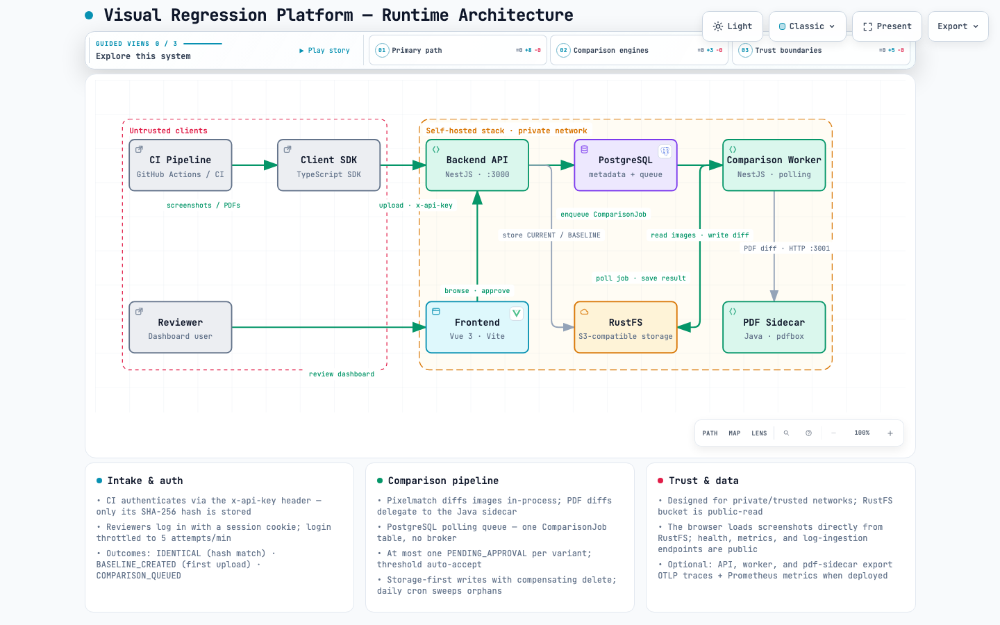
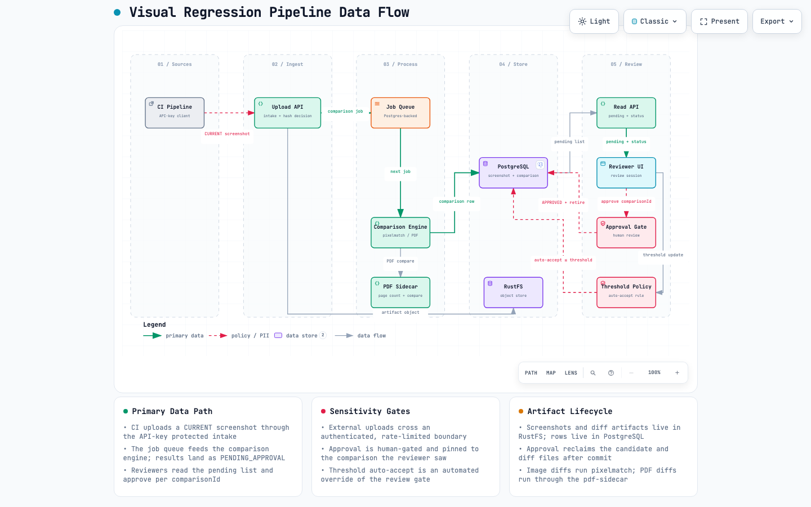

# Visual Regression Testing Platform (WIP)

<p>
  <a href="LICENSE"></a>
  <a href="https://github.com/Fishkob/visual-regression/actions/workflows/ci-backend.yml"></a>
  <a href="https://github.com/Fishkob/visual-regression/actions/workflows/ci-frontend.yml"></a>
</p>

Catch unintended visual changes before they reach production. Upload screenshots from your CI pipeline, compare them pixel-by-pixel against baselines, and approve changes via the web dashboard.

A self-hosted platform for **visual regression testing**, consisting of:

- **Backend** (NestJS + Prisma + RustFS object storage) — manages visual test storage, comparisons, and approvals
- **Frontend** (Vue + Vite + Tailwind) — dashboard for browsing and approving visual tests
- **Client SDK** (TypeScript) — upload screenshots from CI pipelines or automated tests
- **PDF Sidecar** (Java) — PDF comparison via pdfbox
- **Worker** (Node.js) — background comparison job processing

---

## Quick Start (self-hosting)

The fastest way to run the platform is Docker — nothing else is required. You
need [Docker](https://docs.docker.com/get-docker/) (Desktop on macOS/Windows,
engine on Linux) with the daemon running.

```bash
git clone https://github.com/<owner>/visual-regression.git
cd visual-regression
./install.sh            # Docker required — nothing else
```

The installer:

1. Checks Docker + Compose are installed and running.
2. Generates secure random secrets into a gitignored `.env` (Postgres, RustFS,
   admin login, API key) on first run.
3. Builds and starts the full stack, then waits until it is healthy.
4. Prints the URLs and your admin login.

Open the printed **frontend URL** and log in — see [First login](#first-login).

### First login

Where the admin credentials come from depends on how you run the platform:

- **Self-hosting (`./install.sh`)** — `install.sh` generates a random admin
  password and prints it in the success banner ("Admin login"). The same value
  is stored in `.env` as `BOOTSTRAP_ADMIN_PASSWORD`; the username is
  `BOOTSTRAP_ADMIN_USERNAME` (default `admin`). Remove `BOOTSTRAP_ADMIN_*` from
  `.env` after first login.
- **Local dev (`pnpm run dev`)** — a fresh setup bootstraps the admin as
  `admin` / `admin-secret`. Override via `BOOTSTRAP_ADMIN_USERNAME` /
  `BOOTSTRAP_ADMIN_PASSWORD` in `backend/.env.local`.

### Optional: seed demo data

`./install.sh --seed` populates the database with demo projects. Seeding runs
the seed scripts from the repo, so it needs **pnpm** (Node ≥ 24) on the host.
Without pnpm, the installer skips seeding with a hint — you can equally create a
project through the web UI.

> **First build is slow**: the `pdf-sidecar` (Java) and the backend/frontend
> images are compiled from source, which takes several minutes the first time.
> Later builds are fast thanks to Docker layer caching.

### Managing the stack

```bash
./install.sh up      # start / rebuild
./install.sh logs    # follow logs (e.g. ./install.sh logs backend)
./install.sh down    # stop
./install.sh --seed  # add demo data
./install.sh --fresh # wipe all data and start clean
```

> **Lost your `.env`?** Re-running `./install.sh` regenerates it, but an existing
> database volume still holds the old password, so the stack fails to start
> (P1000). Recover with `./install.sh --fresh` — it wipes the volumes and starts
> clean. This erases all data.

### No Docker? Use plain Compose

The same stack runs without the installer wrapper: `docker compose up -d --build`.
If `.env` is missing, copy `.env.example` to `.env` and fill in the secrets.

---

### For contributors (local development with hot reload)

Not running the product? Contributing to the codebase is different — it needs
Node ≥ 24 and pnpm ≥ 10, and hot-reloads backend + frontend:

```bash
# First-time setup: clean slate → infra (postgres, rustfs) → install deps → generate SDK
./scripts/dev.sh reset

# Start backend + frontend with hot reload (starts infra automatically if needed)
pnpm run dev
```

Then open **http://localhost:5173** to see the frontend. See
[docs/local-development.md](docs/local-development.md) for the full reference.

---

### Seed Demo Data (optional)

After the backend is running, populate the database with demo projects and screenshots:

```bash
./scripts/dev.sh seed
```

The seeds hit the authenticated REST API, so they need an API key — create one as described in [CI Authentication](#ci-authentication) below. The seed scripts read `SEED_API_KEY` (or `E2E_API_KEY` for the e2e seeder) from the environment:

- `./scripts/dev.sh seed` sources `backend/.env.local` — set `SEED_API_KEY` there, or set `ADMIN_API_KEY` and `dev.sh` provisions a key automatically via the admin endpoint.
- Running `pnpm run seed:*` directly requires `export SEED_API_KEY=<rawKey>` first, since the scripts don't load dotenv files.

The demo and dev seeds also create **feature branches** to exercise branch-scoped baselines: each branch has one pending review whose first upload inherited the target branch's baseline, unmaterialized tests read as `inherited`, and one branch is archived (`admin-ui/experiment/old-header`). Branch scenarios live in `backend/src/scripts/seeds/fixtures.ts` (`DEMO_BRANCH_SEEDS`, `DEV_BRANCH_SEEDS`).

**RustFS Console:** http://localhost:9001 (login: `rustfsadmin` / `rustfsadmin` — the RustFS default root credentials; override via `RUSTFS_ROOT_USER` / `RUSTFS_ROOT_PASSWORD` in the root `.env` for Docker deployments)

---

### CI Authentication

The product API is authenticated. Browsers authenticate with a session cookie (login via the dashboard); CI pipelines and scripted callers authenticate with an **API key**.

**Create an API key in the dashboard** — sign in and open **API keys** (`/api-keys`). There you can list every key (with its last four characters, owner, created, last use and expiry) and create keys with a name of up to 50 characters, an optional expiry, scopes and project allowlist. Each row offers one action: **Delete** removes the key permanently and it stops authenticating immediately. The raw key is shown once, right after creation. Rotation (with an optional grace window) and revocation with a reason stay available on the API (`POST /api/v1/api-keys/:id/rotate`, `POST /api/v1/api-keys/:id/revoke`).

Key management requires the **browser session** — an API key itself cannot mint, rotate, or revoke keys (`403`), so a leaked CI key cannot escalate into permanent access.

**Create an API key from the CLI** (bootstrap path — requires the `x-admin-key` header set to the configured `ADMIN_API_KEY`):

```bash
curl -X POST http://localhost:3000/api/v1/admin/api-keys \
  -H 'Content-Type: application/json' \
  -H 'x-admin-key: <ADMIN_API_KEY>' \
  -d '{"name":"ci-upload"}'
```

The response contains `rawKey`, which is shown **exactly once** — store it in your CI secret store (only its SHA-256 hash is persisted). Create one key per pipeline/user for easy revocation. The same call accepts an optional `expiresInDays`, an optional `scopes` array (`upload`, `read`, `approve`, `admin`; defaults to `upload` only) and an optional `projectNames` allowlist that confines the key to those projects.

**Send the key on every product API request** via the `x-api-key` header (the header name is configurable via `AUTH_API_KEY_HEADER`):

```bash
curl -X POST "http://localhost:3000/api/v1/projects/my-project/tests/my-test/upload?testKind=image" \
  -H 'x-api-key: <rawKey>' \
  -F 'viewport=desktop' \
  -F 'browser=chromium' \
  -F 'environment=staging' \
  -F 'file=@screenshot.png'
```

The seed scripts authenticate the same way — see [Seed Demo Data](#seed-demo-data-optional) for the exact `SEED_API_KEY` / `E2E_API_KEY` setup.

**Waiting for a comparison / GitHub Action:** see [docs/ci-integration.md](docs/ci-integration.md) for the queued `jobId`, the `wait`-capable job status endpoint, and the composite action.

---

### Ports

| Service        | Local Dev                               | Docker                                  |
| -------------- | --------------------------------------- | --------------------------------------- |
| Frontend       | [localhost:5173](http://localhost:5173) | [localhost:80](http://localhost)        |
| Backend        | [localhost:3000](http://localhost:3000) | [localhost:3000](http://localhost:3000) |
| RustFS API     | [localhost:9000](http://localhost:9000) | [localhost:9000](http://localhost:9000) |
| RustFS Console | [localhost:9001](http://localhost:9001) | [localhost:9001](http://localhost:9001) |
| PDF sidecar    | [localhost:3001](http://localhost:3001) | [localhost:3001](http://localhost:3001) |
| PostgreSQL     | [localhost:5432](http://localhost:5432) | [localhost:5432](http://localhost:5432) |

---

### Stop / Clean Up

```bash
./scripts/dev.sh stop       # Stop containers (data persists)
./scripts/dev.sh delete     # Stop + remove volumes + builds
./scripts/dev.sh reset      # Full reset: delete → infra → local (one-command restart)
```

---

## Environment Configuration

Configuration happens through environment variables, resolved in this order (later wins):

1. **Defaults in `scripts/dev.sh`** — sensible local values (see the `POSTGRES_*` / `RUSTFS_*` vars at the top of the script).
2. **`.env`** (repo root, gitignored) — loaded by `dev.sh` and Docker Compose.
3. **`backend/.env`** — loaded by the backend runtime, the Prisma CLI and `dev.sh`.
4. **`backend/.env.local`** — loaded before `backend/.env`, so it overrides it; only variables already set in the process environment win over the files.

The **local dev** flow creates `backend/.env.local` and `frontend/.env.local` from the `.example` files on first run (via `dev.sh reset`/`local`). The backend runtime and the Prisma CLI read `backend/.env.local` directly, so `pnpm run dev` works on a fresh checkout without exporting anything or creating a symlink. Override these files per-machine without touching git-tracked files.

| File                  | Used by                           | Created by                 |
| --------------------- | --------------------------------- | -------------------------- |
| `.env` (root)         | `dev.sh`, Compose                 | you (optional)             |
| `backend/.env`        | backend runtime, Prisma, `dev.sh` | you (optional)             |
| `backend/.env.local`  | backend runtime, Prisma, `dev.sh` | `dev.sh` (from `.example`) |
| `frontend/.env.local` | frontend runtime                  | `dev.sh` (from `.example`) |
| `.env.local` examples | —                                 | git-tracked templates      |

For Docker deployments, Compose reads the root `.env` automatically. Set the **production credentials** there so both the servers and the app use the same values — the Compose files interpolate these variables (a mismatch between e.g. the PostgreSQL container and the backend's `DATABASE_URL` silently breaks startup):

| Variable                                              | Controls                                                                                                                                                                              |
| ----------------------------------------------------- | ------------------------------------------------------------------------------------------------------------------------------------------------------------------------------------- |
| `POSTGRES_USER` / `POSTGRES_PASSWORD` / `POSTGRES_DB` | PostgreSQL container + backend connection                                                                                                                                             |
| `RUSTFS_ROOT_USER` / `RUSTFS_ROOT_PASSWORD`           | RustFS root credentials (server + app)                                                                                                                                                |
| `RUSTFS_BUCKET`                                       | Storage bucket name                                                                                                                                                                   |
| `RUSTFS_PUBLIC_URL`                                   | Browser-reachable storage base URL — host of every presigned screenshot/PDF URL. Set it for remote deployments                                                                        |
| `CORS_ORIGIN`                                         | Allowed browser origins                                                                                                                                                               |
| `TRUST_PROXY`                                         | Trust `X-Forwarded-For` from the reverse proxy — set `true` behind nginx/ingress so the per-IP login/log rate limits and logging see the real client IP (see Security Considerations) |
| `UPLOAD_RATE_LIMIT_PER_MINUTE`                        | Max uploads per minute per API key. `0` disables (default: `60`)                                                                                                                      |
| `LOGIN_RATE_LIMIT_PER_MINUTE`                         | Max login attempts per minute per IP. `0` disables (default: `5`)                                                                                                                     |
| `LOG_RATE_LIMIT_PER_MINUTE`                           | Max log-ingestion requests per minute per IP. `0` disables (default: `100`)                                                                                                           |
| `BASELINE_HISTORY_LIMIT`                              | Replaced baselines kept per test variant for restore (default: `10`, max: `100`)                                                                                                      |
| `APP_PUBLIC_URL`                                      | Browser-reachable dashboard base used to build links in webhook payloads (default: `http://localhost`)                                                                                |

The backend creates the storage bucket on startup. Screenshots and rendered PDF pages are delivered as **time-limited presigned URLs** (`RUSTFS_SIGNED_URL_TTL_SECONDS`, default `3600`), so the bucket is private by default — no anonymous-read policy is applied. `RUSTFS_PUBLIC_URL` must be the base the **browser** can reach, because it is the host of every presigned URL. Set `RUSTFS_ENSURE_PUBLIC_BUCKET=true` only if an external consumer (e.g. a report exporter) fetches objects without credentials.

---

## Architecture

### Runtime Overview

[](docs/architecture/runtime-architecture.html)

### Repository Layout

```
visual-regression/
├── backend/         # NestJS API server + cron jobs
├── frontend/        # Vue 3 + Tailwind dashboard
├── client-sdk/      # TypeScript SDK for CI pipeline uploads
├── pdf-sidecar/     # Java service for PDF comparison
├── docker-compose.yml           # Full stack
├── docker-compose.infra.yml     # Infra only (postgres, rustfs)
└── scripts/dev.sh               # Development orchestration
```

### Data Flow

[](docs/architecture/visual-regression-pipeline.html)

1. **Upload** — CI pipeline uploads screenshots or PDFs via Client SDK → Backend stores in RustFS
2. **Comparison** — Backend creates comparison job in PostgreSQL → Worker picks up → pixelmatch diff (or pdf-sidecar for PDFs) → stores result
3. **Approval** — Frontend fetches pending comparisons → User approves → Baseline promoted
4. **Baseline** — Approved screenshots become the new baseline for future comparisons

See [docs/architecture/overview.md](docs/architecture/overview.md) for detailed architecture. See [docs/observability.md](docs/observability.md) for the optional OpenTelemetry / Prometheus / Grafana stack.

---

## Testing

Unit tests run without infrastructure:

```bash
pnpm run unitTest                  # Backend unit tests
pnpm run unitTest:cov              # Backend unit tests with coverage
cd frontend && pnpm test           # Frontend unit tests
```

Backend E2E starts the required infrastructure (Postgres, RustFS, pdf-sidecar)
automatically if it is not already running:

```bash
pnpm run e2eTest
```

Frontend E2E (Playwright) drives a browser against the full stack and needs
the frontend, backend, worker, and pdf-sidecar:

```bash
cd frontend && pnpm test-e2e
```

### Frontend E2E: Starting the Stack

Before the first run, start the full stack in Docker (CI does the same):

```bash
./scripts/dev.sh docker            # or: docker compose up -d
```

Install the Playwright browser once:

```bash
cd frontend && pnpm exec playwright install chromium
```

Expected running services (`docker compose ps`):

```text
postgres, rustfs, pdf-sidecar, backend, worker, frontend
```

The worker and pdf-sidecar are mandatory: the worker runs image comparisons
and orchestrates PDF comparisons, which delegate the heavy lifting to the
pdf-sidecar. Without them, comparison jobs produce no result and the tests
time out.

The Playwright run targets `http://localhost:80` by default (or the URL in
the `FRONTEND_URL` environment variable).

### Test Isolation

The E2E tests do not interfere with each other, even across repeated,
back-to-back runs:

- **Unique project names** — each test creates its own project
  (e.g. `e2e-image-<timestamp>-<random>`), so runs never collide.
- **Self-cleanup** — after each test, `afterEach` deletes the project it
  created, leaving no data behind.
- **Sequential execution** — CI enforces `--workers=1` (in
  `playwright-e2e.config.ts`); running locally with the same flag keeps the
  shared worker free of competing upload+compare load.

---

## Development Commands

| Command                    | Purpose                                                 |
| -------------------------- | ------------------------------------------------------- |
| `pnpm start`               | Run the full stack in Docker                            |
| `pnpm run dev`             | Start infra (if needed) + backend/frontend (hot reload) |
| `pnpm run dev:backend`     | Backend only                                            |
| `pnpm run dev:frontend`    | Frontend only                                           |
| `./scripts/dev.sh infra`   | Start infra only (postgres, rustfs, pdf-sidecar)        |
| `./scripts/dev.sh docker`  | Run the full stack in Docker                            |
| `./scripts/dev.sh seed`    | Seed database with demo + e2e + dev data                |
| `./scripts/dev.sh stop`    | Stop Docker services                                    |
| `./scripts/dev.sh reset`   | Full reset: delete → infra → local                      |
| `./scripts/dev.sh delete`  | Stop and remove all data + builds                       |
| `pnpm run bootstrap`       | Install deps + generate SDK + build                     |
| `pnpm run build`           | Build all packages                                      |
| `pnpm run sdk:generate`    | Generate client SDK from OpenAPI                        |
| `pnpm run db:prepare`      | Generate Prisma client + apply migrations               |
| `cd backend && pnpm db:ui` | Open Prisma Studio                                      |

See [docs/local-development.md](docs/local-development.md) for a full reference.

---

## Code Quality

```bash
pnpm run lint              # Backend lint + fix
pnpm run typecheck:all     # Backend + test + frontend type check
pnpm run format            # Format all code
pnpm run format:check      # Check formatting only
```

Recommended order: `lint` → `typecheck:all` → `format` → `unitTest`

---

## Deployment

| Goal                                 | Path                                      | Requires              |
| ------------------------------------ | ----------------------------------------- | --------------------- |
| **Self-hosting** (default)           | `./install.sh`                            | Docker only           |
| **Local development** (hot reload)   | `./scripts/dev.sh reset` → `pnpm run dev` | Docker + Node ≥ 24    |
| **Kubernetes** (Helm chart / ArgoCD) | [docs/deployment.md](docs/deployment.md)  | kubectl + Helm/ArgoCD |

Docker Compose is the self-hosting path — `./install.sh` (or plain
`docker compose up -d --build`) runs the full stack: PostgreSQL, RustFS,
backend, worker, pdf-sidecar, and frontend. Migrations and the RustFS bucket
setup run automatically on startup.

For Kubernetes, a Helm chart ships in `deploy/charts/vrt/` with an ArgoCD
Application manifest and helper scripts in `deploy/scripts/`. That path is
documented separately in [docs/deployment.md](docs/deployment.md).

---

## Roadmap

The gap analysis and the ordered backlog live in
[docs/roadmap.md](docs/roadmap.md): review-noise reduction, diff UX, baseline
history, notifications, run grouping, team roles and the long-tail items. Every
entry carries scope, acceptance criteria, size and dependencies.

---

## Security Considerations

This platform is designed to run in a **private/trusted network**:

- **Authentication** — The product API requires a session cookie (browser login) or an API key (`x-api-key`) for CI/scripted callers. See [CI Authentication](#ci-authentication).
- **Admin endpoints** — `POST /admin/api-keys` and `admin/dlq` are protected solely by the `x-admin-key` header (`ADMIN_API_KEY`); they sit outside the product auth surface so a first API key can be provisioned before any product credential exists. Everything else about a key (list, rotate, revoke, delete) lives on `/api-keys` and is **session-only**: an API key authenticates the product API but cannot manage keys.
- **Bootstrap admin** — The first admin user is created on startup from `BOOTSTRAP_ADMIN_USERNAME` / `BOOTSTRAP_ADMIN_PASSWORD` (only when both are set). Local dev defaults these to `admin` / `admin-secret`; there is no production default. Remove them from the environment after first login. See [First login](#first-login).
- **Rate limits** — every limit is a counter per fixed one-minute window in
  Postgres, so limits hold across all backend instances. Three rules exist:
  uploads are capped per API key (`UPLOAD_RATE_LIMIT_PER_MINUTE`, default 60);
  `/auth/login` is capped per IP (`LOGIN_RATE_LIMIT_PER_MINUTE`, default 5) to
  slow brute force; log ingestion is capped per IP
  (`LOG_RATE_LIMIT_PER_MINUTE`, default 100). Exceeding a limit returns `429`
  with a `Retry-After` header. Setting a limit to `0` disables that rule. The
  upload rule counts only API-key callers; browser sessions never upload.
- **Per-IP rules and proxies** — only the two anonymous endpoints (login, log
  ingestion) are keyed by client IP. Set `TRUST_PROXY=true` when the backend is
  served behind the nginx/ingress reverse proxy so those per-IP rules and
  client-IP logging see the real client IP; keep it `false` when the backend is
  directly reachable (trusting proxy headers from a non-proxy client lets
  anyone spoof their IP and bypass the per-IP limits). Authenticated product
  routes are not IP-limited, so the switch does not affect them.
- **Public by design** — Health, metrics, and log-ingestion endpoints are public; everything else is protected by the global authentication guard.
- **CORS defaults to wildcard** — Configure `CORS_ORIGIN` explicitly in production.
- **Helm chart secrets** — Create `deploy/charts/vrt/values.local.yaml` (gitignored) for local credentials. Use external secrets management (SealedSecrets, External Secrets Operator, SOPS) for production.
- **Storage access is presigned** — The API returns time-limited presigned URLs for screenshots and rendered PDF pages; the bucket needs no anonymous access. Keep `RUSTFS_SIGNED_URL_TTL_SECONDS` short and serve the stack over HTTPS so the signed query string is not exposed in transit. Enabling `RUSTFS_ENSURE_PUBLIC_BUCKET` restores anonymous reads for everyone who can reach RustFS.

See [docs/deployment.md](docs/deployment.md) for production deployment guidance.
