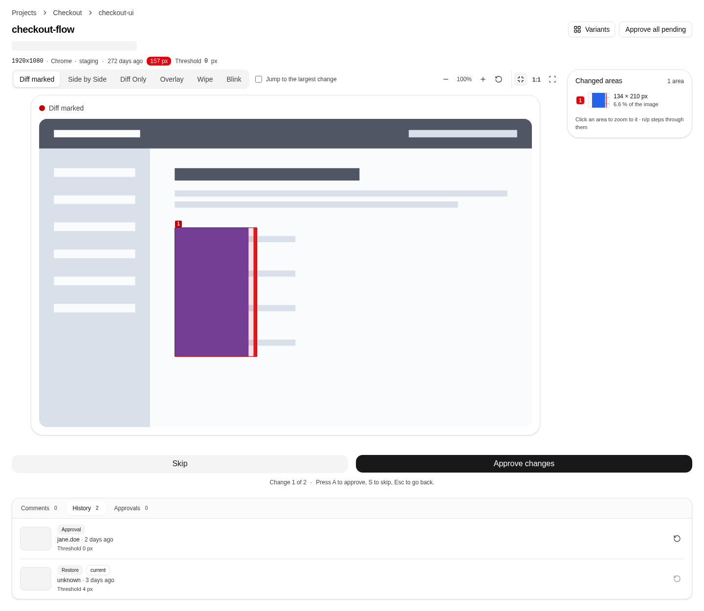
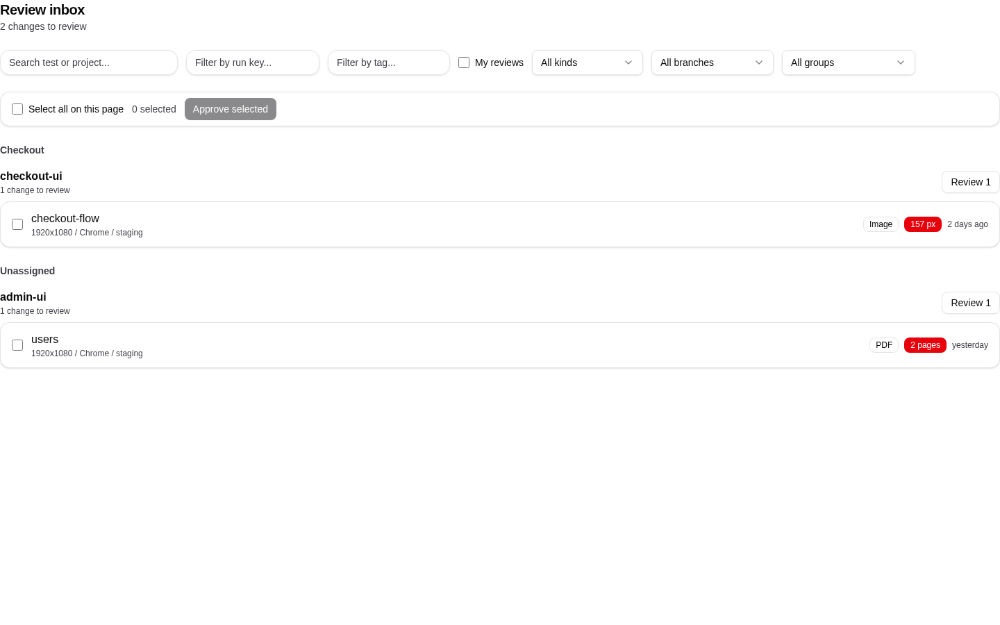
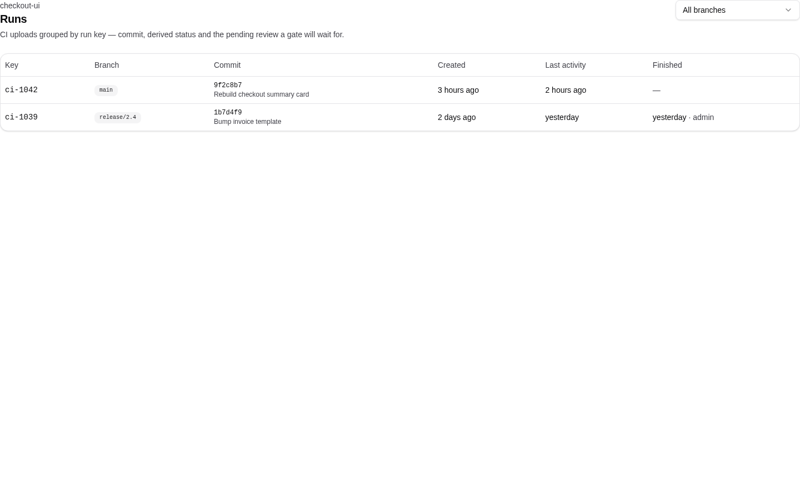

# Visual Regression Testing Platform

[](https://github.com/Fishkob/visual-regression/actions/workflows/ci-backend.yml)
[](https://github.com/Fishkob/visual-regression/actions/workflows/ci-frontend.yml)
[](https://github.com/Fishkob/visual-regression/releases)
[](LICENSE)

<picture>
  <source media="(prefers-color-scheme: dark)" srcset="frontend/tests/quality/__screenshots__/visual-test-details-regions-dark.png">
  
</picture>

Catch unintended visual changes before they reach production. Upload captures from
your CI pipeline, compare them against **branch-scoped baselines**, and approve a
change on a review page built for finding the one block that moved.

Self-hosted with `docker compose` — no cloud account, no per-snapshot billing.

## What it does

- **Review inbox** — every pending change across projects and branches in one
  queue, grouped, filterable, walkable with `A` / `S` / `Esc`.
- **Diff viewer** — marked, side-by-side, only-diff, overlay, wipe and blink, with
  zoom at the cursor and the changed areas listed next to the picture by size.
- **Branch-scoped baselines** — a feature branch inherits its target's baseline and
  only pins its own after the first approval.
- **CI gate** — uploads grouped into a Run, with `open`, `pending`, `failed` and
  `passed` as its state, plus JUnit / HTML / CSV reports.
- **Tolerances as code** — `.vrt.json` next to the tests, a per-variant threshold and
  a project default; a diff within tolerance is auto-accepted, and approval stays
  the only writer of a baseline.
- **Trust** — baseline history with restore, an audit trail, review comments
  and decision reasons.
- **Reach** — signed webhooks (Slack-ready) and read-only share links that show the
  actual pixels.
- **Image and PDF** share one pipeline; the UI is English and German, light and dark.

<table>
  <tr>
    <td width="50%">
      <picture>
        <source media="(prefers-color-scheme: dark)" srcset="frontend/tests/quality/__screenshots__/inbox-dark.png">
        
      </picture>
      <br><sub><b>Inbox</b> — the queue, grouped by project and branch</sub>
    </td>
    <td width="50%">
      <picture>
        <source media="(prefers-color-scheme: dark)" srcset="frontend/tests/quality/__screenshots__/runs-dark.png">
        
      </picture>
      <br><sub><b>Runs</b> — what a pipeline uploaded, and what the gate will wait for</sub>
    </td>
  </tr>
</table>

## Quick start

[Docker](https://docs.docker.com/get-docker/) with Compose v2 is the only
prerequisite (macOS, Linux, or Windows via WSL); the first build takes a few
minutes:

```bash
git clone https://github.com/Fishkob/visual-regression.git
cd visual-regression
./install.sh          # generates secrets, builds the stack, waits for health
./install.sh --seed   # optional: demo projects to click through (needs pnpm)
```

Open <http://localhost> and log in with the credentials the installer printed
(`admin` by default). The password is stored as `BOOTSTRAP_ADMIN_PASSWORD` in the
generated `.env` and should be removed after the first login. If port 80 is taken,
set `FRONTEND_PORT` in `.env` and rerun `./install.sh up`.

Day to day: `./install.sh up`, `down` and `logs` start, stop and tail the stack; an
upgrade is `git pull && ./install.sh up` — the migration job runs before the new
backend. An existing `.env` from before `v2.0.0` also needs a `TOTP_ENCRYPTION_KEY`
(`openssl rand -hex 32`); compose refuses to start without it and names the
variable. `./install.sh --fresh` wipes the database and storage volumes and starts
clean.

Ports and the service layout: [docs/local-development.md](docs/local-development.md#ports).
Production setup (TLS, reverse proxy, backups, Kubernetes):
[docs/deployment.md](docs/deployment.md).

## Wire it into your project

The platform keeps the baselines; your tests keep producing the pixels. Nothing
goes into the application — a capture is the screenshot your test already takes,
and the pipeline fails while a change waits for review.

**1. Give CI a key.** Create one under **API keys** in the dashboard and store it
as a pipeline secret. `upload` sends captures; gating a run also reads its status
(`read`) and finishes it (`admin`) —
[scopes and rotation](docs/ci-integration.md#1-authenticate).

**2. Attach the capture in your test.** One call inside the test you already
have:

```ts
// checkout.spec.ts
test("cart summary", async ({ page }, testInfo) => {
  await page.goto("/cart");

  await testInfo.attach("screenshot", {
    body: await page.screenshot({ fullPage: true }),
    contentType: "image/png",
  });
});
```

**3. Point Playwright at your instance.** The client ships a reporter that uploads
each test's first screenshot attachment and names the test after its title path,
reduced to the characters a name may use (`checkout.spec.ts / cart summary` becomes
`checkout-spec-ts-cart-summary`); a `runKey` groups the uploads of one pipeline
into a run. The client is on npm as `@fishkob/vrt` — install the version that
matches your server ([client SDK](client-sdk/README.md#install)):

```bash
npm i @fishkob/vrt@3.4.0
```

```ts
// playwright.config.ts
import { defineConfig } from "@playwright/test";

export default defineConfig({
  reporter: [
    ["list"],
    [
      "@fishkob/vrt/playwright",
      {
        apiUrl: "https://vrt.example.com/api/v1",
        apiKey: process.env.VRT_API_KEY!,
        project: "checkout",
        branch: process.env.CI_BRANCH || "main",
        viewport: "1920x1080",
        browser: "chromium",
        environment: "staging",
        runKey: process.env.CI_RUN_ID, // groups this pipeline's uploads
      },
    ],
  ],
});
```

The first upload of `checkout-spec-ts-cart-summary` creates the project, the
branch and the baseline; later captures are compared against it. The project name
is yours; a test name is a path segment, so it stays `[A-Za-z0-9_-]` and at most
100 characters. `viewport`, `browser` and `environment` are the Variant — matched
verbatim, case included, so a changed value is a new baseline that passes without
comparing. Any other stack posts the same fields to
`/api/v1/projects/:project/tests/:test/upload?testKind=image`
([curl](docs/ci-integration.md#2-upload-and-wait)).

**4. Gate the pipeline on the run.** After the test command, finish the run and
fail the job unless the gate it returns is `passed` (`$CI_BRANCH` and `$CI_RUN_ID`
are the values your pipeline exports; the status call needs `jq`):

```bash
VRT=https://vrt.example.com
API=$VRT/api/v1/projects/checkout

state=$(curl -sS -X POST "$API/runs/$CI_RUN_ID/finish?branch=$CI_BRANCH" \
  -H "x-api-key: $VRT_API_KEY" | jq -r .status.state)
if [ "$state" != "passed" ]; then
  echo "run $state: $VRT/projects/checkout/runs/$CI_RUN_ID" >&2
  exit 1
fi
```

`pending` is a change nobody decided on yet (or a comparison still running),
`failed` a broken comparison, and `open` is the run you never finished. Approve on
the branch in the inbox; after the merge, delete the branch
([docs/branches.md](docs/branches.md)). Waiting on a single capture, JUnit/HTML/CSV
reports and `.vrt.json` thresholds:
[docs/ci-integration.md](docs/ci-integration.md).

## How it works

1. **Upload** — CI sends a capture (or many, into one run) to
   `/api/v1/projects/:project/tests/:test/upload`.
2. **Compare** — the API queues a job; the worker diffs the capture against the
   variant's baseline (pixelmatch, or the PDF sidecar) and stores the diff.
3. **Review** — a change becomes a pending comparison in the inbox; approve,
   comment or skip.
4. **Approve** — the capture becomes the baseline, the outgoing one is kept as
   revision for restore, and the change reaches the audit trail and the webhooks.

More detail and diagrams: [docs/architecture/overview.md](docs/architecture/overview.md).

## Documentation

| I want to…                                         | Read                                                   |
| -------------------------------------------------- | ------------------------------------------------------ |
| put it into a pipeline                             | [docs/ci-integration.md](docs/ci-integration.md)       |
| clean up a branch after its merge                  | [docs/branches.md](docs/branches.md)                   |
| run it locally / contribute                        | [docs/local-development.md](docs/local-development.md) |
| deploy it (Kubernetes, TLS, backups, secrets)      | [docs/deployment.md](docs/deployment.md)               |
| know what the test suites cover                    | [docs/testing.md](docs/testing.md)                     |
| send review events somewhere                       | [docs/webhooks.md](docs/webhooks.md)                   |
| understand roles, keys and API scopes              | [docs/permissions.md](docs/permissions.md)             |
| understand a term (`Variant`, `Run`, `Threshold`…) | [CONTEXT.md](CONTEXT.md)                               |
| see why something is the way it is                 | [docs/adr/](docs/adr/) — 53 decision records           |
| know what is next                                  | [docs/roadmap.md](docs/roadmap.md)                     |

## Status

Every release is a semver tag and the **Latest release** badge above shows the
newest; the changelog is generated from conventional commits. The local gate
(`./scripts/verify.sh`) runs lint, typecheck, the backend and frontend unit suites
with a per-layer coverage gate, the i18n parity check and the SDK drift check;
`--with-e2e` and `--with-browser` add the HTTP and Playwright suites, and
`--with-quality` the visual and accessibility runs in the quality image.

The screenshots above are that suite's own baselines: the gallery renders every
page in light and dark and scans it with axe, so the pictures here cannot silently
drift from the app — and `gallery-coverage.test.ts` fails the unit suite for a
route that has no case. Suite layout and coverage rules:
[docs/testing.md](docs/testing.md).

## Security Considerations

This platform is built to run in a **private/trusted network**:

- Browsers authenticate with a session cookie, CI with an API key. Key management
  (create, rotate, revoke) is session-only, so a leaked CI key cannot mint a new one.
- `POST /admin/api-keys` and `/admin/dlq` sit outside the product auth surface and
  are protected by `ADMIN_API_KEY`, so the first key can be provisioned before any
  credential exists. They, `/metrics` and `/health` are token-guarded and rate-limited.
- Screenshots and PDFs are served as short-lived presigned URLs; the bucket needs no
  anonymous access.
- Webhook endpoints are admin-only and pass an SSRF guard (loopback, link-local and
  cloud-metadata are refused; RFC1918 is allowed on purpose for self-hosting).
- Rate limits cover uploads, login, log ingestion and the operator surfaces; see
  [docs/deployment.md](docs/deployment.md) for `TRUST_PROXY`, CORS, session lifetime
  and the rest of the production checklist.

Vulnerability reports: [SECURITY.md](SECURITY.md).

## License

[MIT](LICENSE)
