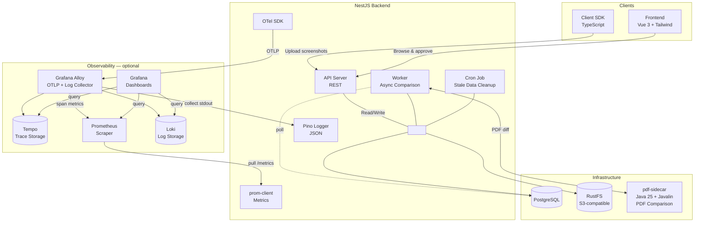
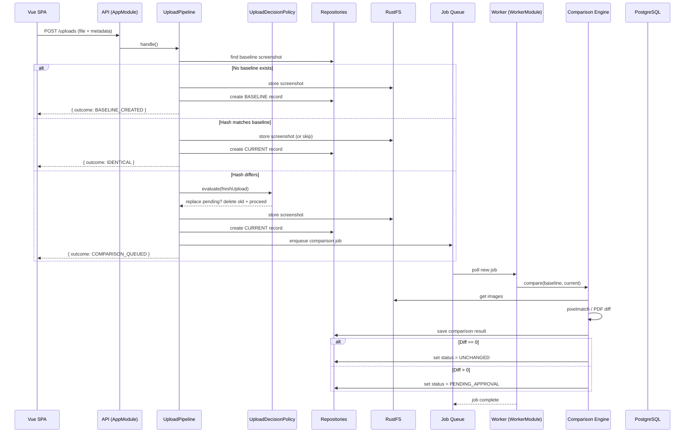
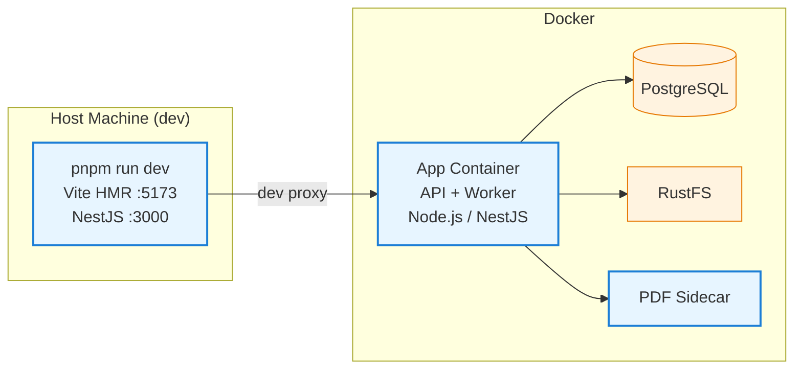

# Architecture Overview

## Container View



**Solid lines** = always active. The **Observability box** = optional — only present when those components are deployed and configured.

The BUS node represents the shared data access layer — all backend services read from and write to PostgreSQL and RustFS.

## Backend Layered Architecture

Every sub-module follows a consistent layered structure:

```
module/
├── presentation/    HTTP controllers, DTOs, Swagger
├── application/     Orchestration services (use cases)
├── domain/          Entities, value objects, domain types
└── infrastructure/  Prisma repositories, mappers
```

- **Cross-cutting ports** (`IStorageProvider`, `IComparisonEngine`) live in `common/domain/` — infrastructure depends on domain, not the other way around. There is no event bus: observability emission is a synchronous switch in `StateChangeWorkflow`'s post-commit path (see [ADR-004](../adr/004-infrastructure-patterns.md)).
- **Repositories** are injected by class token (no separate interface) — consistent with every other service
- **In-memory test doubles** replace repositories by class token for isolated unit testing

## Module Graph

```mermaid
graph TB
  classDef boundary fill:#f8f9fa,stroke:#868e96,stroke-width:2px,stroke-dasharray:6 3
  classDef external fill:#e7f5ff,stroke:#1c7ed6,stroke-width:1px
  classDef nestjs fill:#fff3e0,stroke:#e67700,stroke-width:2px
  classDef domain fill:#f3f0ff,stroke:#7048e8,stroke-width:1px
  classDef infra fill:#ebfbee,stroke:#2b8a3e,stroke-width:1px
  classDef vue fill:#fff0f6,stroke:#c2255c,stroke-width:1px

  subgraph Browser["Browser"]
    direction LR
    SPA["Vue 3 SPA<br/>TanStack Query<br/>Tailwind v4"]
  end

  subgraph Server["Node.js Server (Port 3000)"]
    direction TB

    subgraph API["API Mode — AppModule"]
      direction TB
      HTTP["HTTP Layer<br/>Helmet · CORS · Rate Limit<br/>Global ValidationPipe · Exception Filter"]

      subgraph Feature["Feature Module: visualTest/"]
        direction TB
        Intake["Intake<br/>Upload Controller<br/>UploadPipeline(s)"]
        Review["Review<br/>TestsQueries · TestCommands · Pdf<br/>ProjectsController · ApprovalsController"]
        Core["Core<br/>Entities · Policies<br/>Application Services"]
      end

      subgraph Internal["Internal Modules"]
        Health[Health (/health)]
        Metrics[Metrics (/metrics)]
        Dlq[Dead-Letter Queue]
        DataDel[Data Deletion (cron)]
        LogIng[Log Ingestion]
      end
    end

    subgraph Worker["Worker Mode — WorkerModule"]
      direction TB
      Poller["Job Poller<br/>(Postgres polling)"]
      Processor["Job Processor<br/>ComparisonJobProcessor"]
      Engines["Engines<br/>Pixelmatch (image) · PDF Sidecar Client"]
    end

    subgraph Shared["Shared Infrastructure"]
      direction TB
      Prisma["Prisma ORM<br/>UnitOfWork · AdvisoryLock<br/>4 Repositories"]
      Storage["RustFS Storage<br/>IStorageProvider"]
      Bus["Observability<br/>Logger + Metrics (in-process)"]
      JobQ["Job Queue<br/>Postgres-backed"]
      Otel["OpenTelemetry<br/>Traces · Spans"]
    end
  end

  subgraph External["External Systems"]
    PG[("PostgreSQL<br/>Single database")]
    RustfsS3[("RustFS<br/>S3-compatible storage")]
    SidecarSvc["PDF Sidecar Service<br/>(PDF comparison)"]
  end

  SPA -->|HTTP /api/v1/*| HTTP

  HTTP --> Intake
  HTTP --> Review
  Intake --> Core
  Review --> Core

  Core --> Prisma
  Core --> Storage
  Core --> Bus
  Core --> JobQ

  Prisma --> PG
  Storage --> RustfsS3
  JobQ -->|poll| Poller
  Poller --> Processor
  Processor --> Engines
  Engines --> Prisma
  Engines --> Storage
  Engines --> SidecarSvc

  Bus --> Otel
  Bus --> Metrics

  class Browser vue
  class API,Worker nestjs
  class Core,Intake,Review domain
  class Prisma,Storage,Bus,JobQ,Otel infra
  class External external
```

## Components

| Component                         | Technology                        | Purpose                                                                        |
| --------------------------------- | --------------------------------- | ------------------------------------------------------------------------------ |
| **Backend API**                   | NestJS + Prisma                   | REST API for visual test management                                            |
| **Worker**                        | NestJS (separate app)             | Async image and PDF comparison via PostgreSQL-backed queue                     |
| **Frontend**                      | Vue 3 + Tailwind + TanStack Query | Dashboard for browsing & approving visual tests                                |
| **Client SDK**                    | TypeScript (generated)            | Auto-generated OpenAPI client for CI pipeline uploads                          |
| **Database**                      | PostgreSQL                        | Projects, visual tests, screenshots, comparisons, jobs                         |
| **Storage**                       | RustFS (S3-compatible)            | Screenshot images, diff images                                                 |
| **Comparison Engine<br/>(Image)** | Pixelmatch                        | Pixel-level image diffing (Node.js, in-worker)                                 |
| **Comparison Engine<br/>(PDF)**   | pdfcompare (Java)                 | Page-by-page PDF diffing via pdf-sidecar (HTTP)                                |
| **Queue**                         | PostgreSQL (polling)              | Async comparison jobs (single `ComparisonJob` table, `testKind` discriminator) |
| **Data Deletion**                 | Cron                              | Orphaned comparison cleanup (daily)                                            |
| **OTel SDK**                      | OpenTelemetry JS                  | Generates spans for HTTP requests (optional)                                   |
| **Grafana Alloy**                 | Grafana Alloy                     | Receives OTLP traces, ships Docker logs to Loki                                |
| **Tempo**                         | Grafana Tempo                     | Trace storage (query by TraceID or service graph)                              |
| **Prometheus**                    | Prometheus                        | Pulls /metrics endpoint and Alloy span-metrics                                 |
| **Loki**                          | Grafana Loki                      | Log storage (label-based queries, similar to Prom)                             |
| **Grafana**                       | Grafana                           | Unified dashboards for traces, logs & metrics                                  |

## Data Flow

### Upload Sequence



### Image Pipeline

1. **Upload**: CI pipeline uploads screenshots via Client SDK → Backend stores in RustFS
2. **Comparison**: Backend creates `ComparisonJob` in PostgreSQL → Worker polls → pixelmatch diff (in-process) → stores result
3. **Approval**: Frontend fetches pending comparisons → User approves → Baseline promoted in transaction
4. **Baseline**: Approved screenshots become new baseline — next upload compares against these

### PDF Pipeline

1. **Upload**: CI pipeline uploads PDF documents → Backend stores in RustFS
2. **Comparison**: Backend creates `ComparisonJob` (with `testKind: 'pdf'`) in PostgreSQL → Worker polls → Worker calls pdf-sidecar (HTTP, Java process) → stores result
3. **Approval**: Frontend (or API) fetches pending comparisons → User approves → Baseline promoted in transaction
4. **Baseline**: Approved PDFs become new baseline — next upload compares against these

## Architecture Philosophy (startup-pragmatic vs. enterprise)

| Area                  | This Platform                             | Typical Enterprise                          |
| --------------------- | ----------------------------------------- | ------------------------------------------- |
| **Queue**             | PostgreSQL polling (single worker)        | RabbitMQ, SQS, Kafka (multi-worker, DLQ)    |
| **API Surface**       | Monolithic NestJS (one process)           | API Gateway + BFF + multiple microservices  |
| **Auth**              | Session cookie (dashboard) + API key (CI) | OAuth2/OIDC, SSO, RBAC, audit logging       |
| **Multi-tenancy**     | Single-org deployment                     | Tenant isolation, schema-per-tenant         |
| **Observability**     | Health checks + Prometheus metrics        | Distributed tracing, SLIs/SLOs, alerting    |
| **Storage Delivery**  | Direct RustFS URLs                        | CDN + signed URLs + caching layer           |
| **Database Topology** | Single PostgreSQL instance                | Read replicas, connection pooling, sharding |
| **Service Mesh**      | None (direct Docker Compose)              | Istio/Linkerd for mTLS, traffic management  |

**Key tradeoffs made deliberately:**

- Two comparison engines (Pixelmatch + pdfcompare) — image and PDF comparison have fundamentally different algorithms; a separate Java sidecar avoids blocking the Node.js event loop with CPU-bound PDF rendering/compare work
- Redis was removed (see [ADR-004 (Infrastructure Patterns)](../adr/004-infrastructure-patterns.md)) — BullMQ's feature set (priorities, delayed jobs, multi-worker) was overkill for a single-queue system
- No API gateway — one backend serves both frontend and CI; auth is delegated to the trusted network
- No multi-tenancy — each deployment serves one organization; self-hosted instances are isolated by deployment
- Single DB instance — read replicas add operational cost with negligible benefit at current scale

The codebase invests complexity where it pays off: **clean layered architecture**, **domain-driven language** (CONTEXT.md), **[architecture decision records](../adr/README.md)** that keep the why next to the seam, **ports-and-adapters** for testability, and a **single transactional write seam** (`StateChangeWorkflow`) instead of a message bus between intake and review.

## Deployment



## Key Patterns

| Pattern                                  | Where                                                                                                               | Why                                                                              |
| ---------------------------------------- | ------------------------------------------------------------------------------------------------------------------- | -------------------------------------------------------------------------------- |
| **Dual-mode deployment**                 | `AppModule` (API) / `WorkerModule` (worker)                                                                         | Separate concerns — API serves requests, worker processes background comparisons |
| **Strategy pattern**                     | `COMPARISON_ENGINES`, `MAINTENANCE_TASKS`                                                                           | Swap comparison engines or maintenance jobs without editing callers              |
| **Ports & Adapters**                     | `IStorageProvider` → `RustFsStorageService`, `IComparisonEngine` → `PixelmatchComparisonService`/`PdfSidecarClient` | Infrastructure depends on domain, not the other way around                       |
| **Transaction with compensating delete** | Upload pipeline                                                                                                     | Storage write is outside DB transaction; if DB fails, stored file is deleted     |
| **Postgres-backed job queue**            | No Redis/RabbitMQ                                                                                                   | Simplifies ops — one fewer external dependency                                   |
| **Post-commit observability emission**   | `StateChangeWorkflow` switch on `ObservabilityEvent` records                                                        | Logger + metrics emitted directly after commit, no event bus / outbox pattern    |
| **Auto-generated SDK**                   | Prisma → Swagger → OpenAPI → `@hey-api/openapi-ts` → `client-sdk/`                                                  | Single source of truth for API types; zero manual DTO sync                       |
| **Domain-driven frontend**               | `domains/` with model + mapper + query-keys                                                                         | Each backend domain has a mirrored frontend structure                            |
